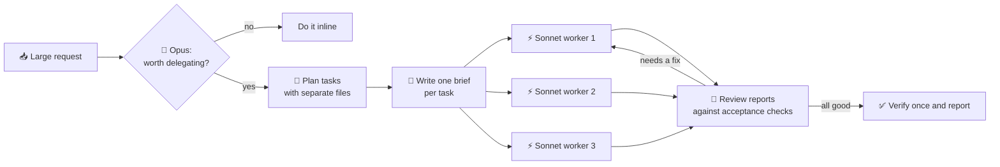

# 🧠 Opus Plans, ⚡ Sonnet Executes

**A Claude Code skill that puts Opus in charge of planning and hands the work to Sonnet.**

Large requests can burn through Opus tokens on reading files, running commands and writing boilerplate. This skill moves that work to Sonnet and keeps Opus for planning and review.

---

## The philosophy

> **Opus thinks. Sonnet types.**

On a building site, the architect doesn't lay bricks. The architect draws the plan, hands a clear spec to each crew and checks the finished work. The crews build.

AI work splits the same way:

| | 🧠 **Opus (the architect)** | ⚡ **Sonnet (the crew)** |
|---|---|---|
| **Good at** | Judgment, trade-offs, ambiguity | Fast, accurate execution of clear instructions |
| **Spends tokens on** | Scoping, planning, briefs, review | Reading, editing, running, searching |
| **Cost** | Higher, so spend it on decisions | About half the price per token, so spend it on volume |

Three ideas drive the design:

1. **A good brief is worth more than a smart worker.** Most failed delegation comes from vague instructions, not weak models. Every task goes out with a written brief: goal, context, owned files, steps, acceptance checks and what's out of scope.
2. **Delegation has a cost.** Every worker starts with an empty context and has to rebuild it. A three-line fix is cheaper to just do. The skill delegates only when the work is big enough to be worth it.
3. **More effort is not always better.** At max effort, Sonnet tends to start too many subagents of its own. Workers here run at high effort, never max, and cannot start agents of their own.

---

## How it works



1. **Gate.** Delegate only if the work splits into separate tasks, or one task is long (more than ~15 tool calls), **and** no two tasks need to edit the same file.
2. **Plan.** Opus reads just enough to split the work and shows you the plan.
3. **Brief.** Each task gets a brief that stands on its own. The worker never saw your conversation.
4. **Dispatch.** Independent tasks run in parallel on Sonnet.
5. **Review.** Opus checks each report against its acceptance criteria. If something is wrong, it sends the fix back to the same worker instead of redoing the work itself.
6. **Integrate.** One final build or test run, then a short report back to you.

### The brief every worker gets

```
GOAL:         one sentence: the outcome, not the steps
CONTEXT:      what the worker can't know: decisions, conventions, paths
OWNED FILES:  the only files it may touch
STEPS:        numbered and concrete
ACCEPTANCE:   commands to run and what passing looks like
OUT OF SCOPE: adjacent things to leave alone
REPORT:       status, files changed, test output, questions (under 200 words)
```

The 200-word report cap also saves tokens: Opus reads short summaries instead of long transcripts.

---

## What's inside

```
skills/opus-plan-sonnet-execute/SKILL.md   # the playbook Opus follows
agents/sonnet-worker.md                    # the Sonnet worker: model + effort pinned, can't spawn agents
```

---

## Install

```bash
git clone https://github.com/mbdwey/opus-plan-sonnet-execute.git
cd opus-plan-sonnet-execute

mkdir -p ~/.claude/skills ~/.claude/agents
cp -r skills/opus-plan-sonnet-execute ~/.claude/skills/
cp agents/sonnet-worker.md ~/.claude/agents/
```

Start a new Claude Code session so it picks them up.

> 💡 Prefer symlinks (`ln -s`) over copies if you want `git pull` to update the skill automatically.

---

## Use it

1. Run your session on **Opus** (`/model`). The savings depend on Opus being the planner.
2. Give it something big:
   > "Add authentication, a settings page and an audit log to this app."
3. Watch Opus post a plan, send out briefs and review the results.

You can also call it directly: *"use the opus-plan-sonnet-execute skill for this."*

**Make it trigger reliably.** Claude decides when a skill applies, so it can miss. Add one line to `~/.claude/CLAUDE.md`:

```
For large or multi-part requests, use the opus-plan-sonnet-execute skill.
```

---

## When it *won't* delegate

- Small or single-file changes, where delegating costs more than it saves
- Tasks that would all edit the same files, which would cause conflicts
- Quick questions and explanations

---

## Customize

| Want to... | Change |
|---|---|
| Approve every plan before work starts | In `SKILL.md`, step 2, replace "then proceed" with "then wait for approval" |
| Cheaper workers | `effort: medium` in `agents/sonnet-worker.md` |
| Read-only research workers | Remove `Edit, Write` from the agent's `tools:` line |
| Use with a newer model | Change `model:` in the agent file |

---

## License

MIT. Use it, fork it, improve it. PRs welcome.
